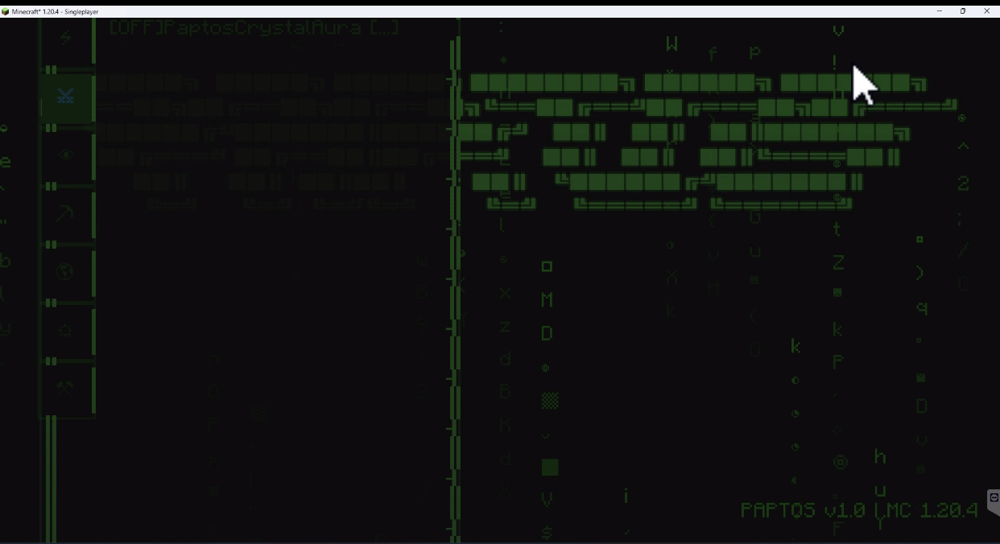

  

https://unaveragetech.github.io/Paptos_client/

<h1 align="center">PAPTOS Client v1.0</h1>

<em>Precision in Every Packet</em>

---

**Version:** Minecraft 1.21 
**Mode:** Base Hunting | Crystal PvP

Step into the shadows with **PAPTOS**, a next-gen combat and exploration utility forged for elite Crystal PvP players and base hunters. Designed with a Rasta aesthetic and hyper-focused modular structure, PAPTOS strips away the clutter and arms you with only what matters most in the fight for supremacy, + lots of Qol

### 🔍 Core Modules

- **Movement** – Close the gap or escape with precision.  
- **Combat** – Engineered for Crystal PvP speed and dominance.  
- **Render** – Visual clarity for traps, stashes, and obfuscated bases.  
- **World** – Manipulate terrain data to reveal hidden strongholds.  
- **Client** – 2 active utility mods; lightweight, fast, efficient.

### 🧠 Terminal Interface

Navigate with your keyboard. Filter modules. See only what matters.  
A minimal, green-on-black matrix for those who move in silence.

### 🛰️ Key Features

- ⚡ Instant module toggling  
- 🔒 Low memory footprint  
- 👁️‍🗨️ Perfect for stealthy stash raiding and off-meta PvP  

---
gallery 
---
---

  

---

> “Find the base. Drop the crystals. Leave no trace.”
